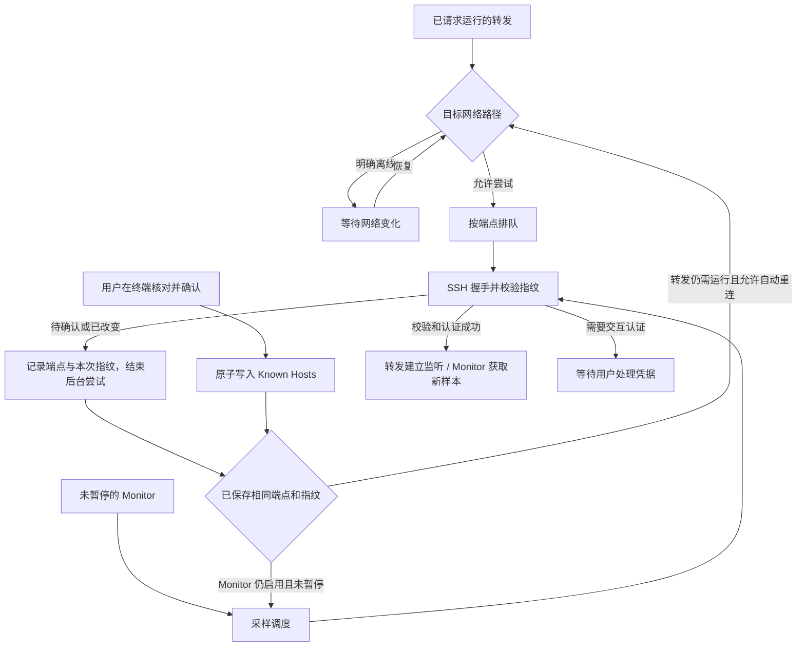

# Port Forwarding 网络与主机信任恢复

Windows 试用版，2026-11-23。Port Forwarding 和 Monitor 通过应用的 Known Hosts 指纹库判断 SSH 主机信任是否已经恢复。

## 用户看到的行为

已启用自动重连的服务在明确离线时显示 `Waiting for network`。这段时间没有重试倒计时，也不发起 SSH、远端监听检查或认证请求。用户随时可以点 Stop。有可用路径后，应用自行尝试连接，远端确认监听成功后才显示 `Tunnel established`。

以办公室的两条转发为例，一条连接有线局域网，另一条连接 VPN。VPN 断开时，仍然工作的局域网隧道继续传输。如果能确认 VPN 目标已失去可用路径，只让这一条等待。若 VPN 服务器宕机而本机仍有路由，只有这台服务器的规则进入退避重试。

## 判定与动作

| 观测到的情况 | 卡片状态 | 调度行为 |
| --- | --- | --- |
| 用户停止、删除规则 | Stopped 或移除卡片 | 取消进行中的连接、等待和排队任务。网络恢复和应用重启都不能重新启动已停止的规则。 |
| 明确离线，或目标所有可用候选地址都无可用路径 | Waiting for network | 取消该规则尚未完成的建连和退避定时器，保留运行意图。等待网络变化事件。 |
| 路径出现或电脑唤醒 | Checking network，随后 Connecting 或继续等待 | 重新读取网卡、路由与目标地址。只把路径恢复的等待项放入建连队列。 |
| 有可用路径，但连接超时、被重置或 SSH 服务暂时拒绝 TCP 连接 | Retrying in … | 按规则退避，连续失败时无限重试。每次真正建连前重新判断网络。 |
| 主机密钥首次出现或发生变化 | Needs attention | 保存本次握手报告的 SSH 端点与指纹。用户在终端确认后，符合自动重连条件的规则重新检查网络并排队。 |
| 凭据被拒或 SSH 服务端明确拒绝建立远端监听 | Needs attention | 记录具体原因，保留现有核验与端口冲突处理。修正凭据、配置或端口后，由用户 Retry。 |
| 远端监听已建立 | Tunnel established | 保持当前隧道。单个转发流失败、本机目标服务未启动，仅影响流或服务状态。 |
| 用户关闭自动重连后，已运行隧道中断 | Connection failed | 保留手动 Retry。后续网络变化不触发后台重连。 |

状态判断使用连接阶段和结构化错误原因。TCP 连接服务器端口失败、SSH 服务器拒绝远端监听，以及本机业务端口拒绝连接，是三条不同的路径。网络变化与认证失败同时到达时，已确认的认证或信任问题优先进入 Needs attention。未完成握手时发生的网络中断仍走网络恢复流程。

## 后台连接的恢复路径

转发和 Monitor 在各自的调度周期内核对等待项。用户取消、写入失败、移除记录或确认其他端点时，等待项继续等待。用户确认得早于后台错误到达时，下一次调度仍能从磁盘读到确认结果。重新建连时 SSH 会再次执行指纹校验。Monitor 自动恢复只发起采样，已提交的结束进程操作不会重放。

## 怎样确认网络恢复

- 整个应用共用一个网络观察器。启动时订阅 IPv4/IPv6 接口及路由变化并读取初始快照。回调只通知管理器重新评估。Windows 的首次订阅通知仅确认注册成功。[接口变化通知](https://learn.microsoft.com/en-us/windows/win32/api/netioapi/nf-netioapi-notifyipinterfacechange) · [路由变化通知](https://learn.microsoft.com/en-us/windows/win32/api/netioapi/nf-netioapi-notifyroutechange2)
- 对目标区分三种结果：有本机可用路径、明确无路径、暂时无法判断。对已解析的地址，结合到目标的路由、出口接口和可用源地址逐个判断；有任一候选地址可用即可尝试。局域网、VPN 和回环目标按各自路径判断。Windows 的公网联网提示只供参考。[按目的地址查询最佳路由](https://learn.microsoft.com/en-us/windows/win32/api/netioapi/nf-netioapi-getbestroute2)
- DNS 超时、单个 SSH 超时、路由查询 API 报错都不足以宣告离线。目标是域名时，网络恢复后重新解析。VPN 断开后若仍有普通默认路由，而应用无法证明该目标必须经过 VPN，则按「暂时无法判断」处理，以有限频率尝试该目标。
- 恢复事件合并约 1 秒，等网卡、地址、DNS 和路由就绪。已确认离线时，每 30 秒兜底复核本机网络状态，以覆盖通知丢失。这个复核由应用共享，期间 SSH 连接尝试数应为零。网络状态长期未知时，按单规则退避，避免永久等不到一次通知。
- 睡眠期间不累计失败次数。唤醒时重新读取网络状态；健康隧道继续使用，存疑的旧会话先做有应答、带超时的存活检查。只有检测到传输失效才安排替代连接。当前 libssh 路径发送 SSH IGNORE；单纯成功写出保活包不足以证明对端仍可应答。

## 并发、退避与用户意图

沿用已有的 `desired`（用户希望运行）和 `retry`（掉线后允许自动恢复）。`Manager` 统一决定何时安排任务，SSH 工作线程只负责一次连接、监听与传输，并报告结果。后台调度独立于页面是否打开。

1. 启动或重启应用时先恢复已保存的运行意图，再检查目标路径。自动重连开启的规则即使在离线时启动也只排队等待。关闭自动重连的规则保留一次显式启动或启动恢复的机会；若当时明确离线，直接给出可手动重试的结果。
2. 网络确认恢复后，等待项跳过断网前剩余的退避时间。合并重复通知，并限制恢复并发。建议首版全局同时建立至多 4 条隧道，同一 SSH 端点一次建立 1 条，其余公平排队。已经建立的隧道不占建连名额。
3. 对仍有路径的临时故障保留 1、2、4、8、16、30 秒退避，上限 30 秒，略微错开各规则的重试时刻。建议隧道稳定运行 30 秒后清零失败次数，避免每次刚监听成功就掉线的规则持续每秒重连。网络恢复期间反复抖动也须复用同一队列。
4. 每条规则同时只有一个有效任务。停止、删除或更改连接配置使旧任务作废；过期的连接成功、失败和定时器回调一律丢弃。编辑后只按最新的运行意图和配置重新评估。关闭自动重连时取消后台重试和网络等待，健康隧道可继续运行。
5. 手动 Retry 立即重新判断目标路径。仍明确离线时更新原因；有路径时可跳过退避执行一次。诊断详情保留最近的失败原因、最后一次真实尝试的时间，以及正在等待网络、用户操作还是下一次重试。

## 验收场景

| 场景 | 可观察结果 |
| --- | --- |
| 明确离线 10 分钟后接回网络 | 等待期间 SSH 尝试数为 0；网络恢复后自动发起一次有效连接，成功后才显示已建立。 |
| 公网不可达，局域网主机仍可达；或只有 VPN 断开 | 可用目标持续工作；单个目标失败不会暂停全局。 |
| 网络可用，某台服务器关机后恢复 | 只有对应规则退避，第 7 次及以后仍可重试；其他服务不受影响。 |
| 多条规则同时等待，系统连续报告多次网卡和路由变化 | 同一规则没有重复任务，遵守并发上限，已运行服务不会被批量重启。 |
| 等待期间 Stop、删除、改主机，或关闭自动重连 | 旧服务、旧配置均不会被恢复事件拉起。 |
| 密钥变化、认证失败、业务服务关闭 | 前两种等待人工处理；本机业务服务关闭时，已建立的 SSH 隧道继续运行。 |
| 休眠唤醒、恢复通知丢失、DNS 或 IPv6 单独失败 | 不补发睡眠期间的请求；可用地址仍可连接；兜底复核可以唤醒等待任务。 |
| 网络频繁切换，隧道连续建立后立即掉线 | 只有一个有效会话，重试保持退避。 |
